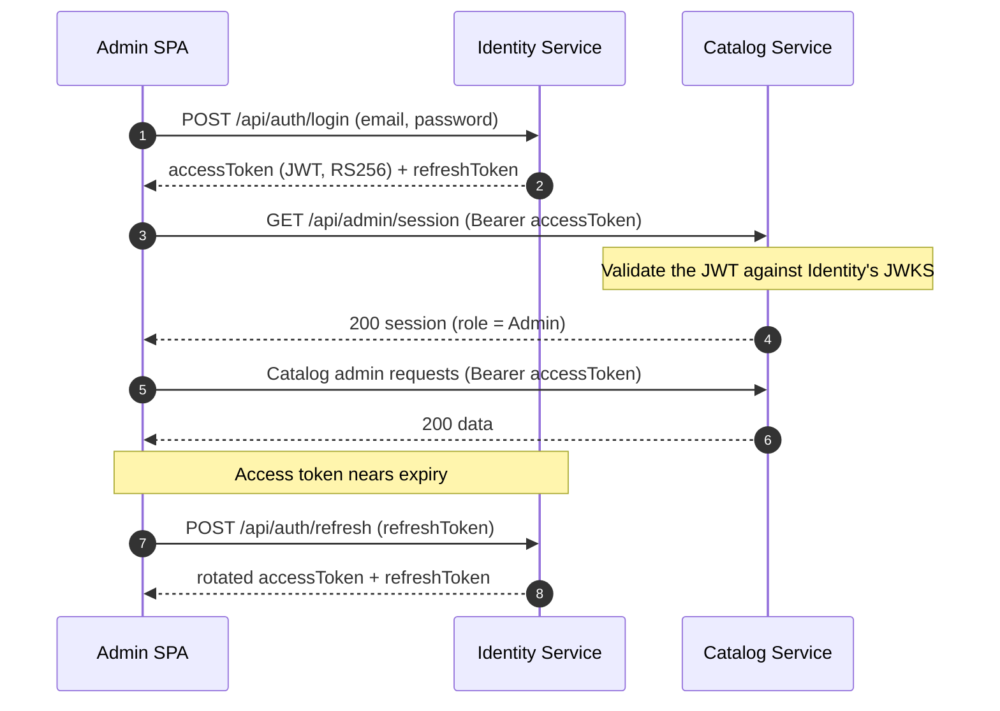

# LiteCommerce

LiteCommerce is an e-commerce platform built on a **microservice architecture**. It pairs a cross-platform **Blazor WebAssembly** admin SPA with a set of independent, independently deployable backend services, each owning its own data store.

Authentication and authorization are handled by a dedicated **Identity service** that issues JWTs; downstream services (starting with Catalog) validate those tokens through OpenID Connect discovery, so no service shares a signing secret.

## Authentication flow



## Services

### 1. Identity Service — Implemented
Owns users, roles, and the issuing of tokens. It is the trust anchor for the platform.
- Registration, login, refresh-token rotation, logout/revoke, and change password
- **RS256 JWT** signed with PEM keys, published through OpenID Connect discovery
  (`/.well-known/openid-configuration`) and a JWKS endpoint (`/.well-known/jwks.json`)
- Role-based access control (`Admin`, `Staff`, `Customer`) with an `AdminOnly` policy
- Account lockout after repeated failed logins and per-IP rate limiting on auth endpoints
- Row-level audit log and admin activity log, exposed over admin-only read endpoints
- Clean Architecture layering; no CQRS — the controller delegates straight to an auth service

### 2. Catalog Service — Implemented
Manages the product catalog through an admin API used by the Blazor admin app.
- Brands, categories (hierarchical), product options, attributes, and templates
- Products with pricing, images and documents, SEO fields, and related products
- Bulk price updates with price history
- Audit log (row-level data changes) and activity log (admin actions)
- Clean Architecture with CQRS (MediatR)
- **Validates Identity-issued JWTs** (via JWKS) and enforces the `AdminOnly` policy on admin endpoints

### 3. Inventory Service — Not Yet Implemented
Tracks and manages stock levels for products.
- Real-time stock updates
- Integration with order processing

### 4. Order Service — Not Yet Implemented
Manages the lifecycle of orders.
- Cart and checkout functionality
- Order tracking and status updates

### 5. Payment Service — Not Yet Implemented
Processes payments securely.
- Integration with payment gateways
- Refund management

### 6. Shipping Service — Not Yet Implemented
Handles logistics and shipping management.
- Shipping cost calculation
- Integration with external logistics providers

### 7. Notification Service — Not Yet Implemented
Sends notifications to users.
- Email, SMS, and push notifications
- Event-driven architecture for real-time updates

### 8. Promotion and Discount Service — Not Yet Implemented
Manages promotional offers and discounts.
- Coupon code generation
- Discount application rules

## Security model

- **Single signer, many verifiers.** Only Identity holds the private key. Catalog (and any
  future service) validates access tokens against Identity's public JWKS, keyed by the
  RFC 7638 `kid`. Rotating the PEM files rotates the key with no shared-secret redistribution.
- **Short-lived access tokens, rotating refresh tokens.** Access tokens are short-lived;
  refresh tokens are single-use and rotated on every refresh, with reuse detection that
  revokes all of a user's sessions.
- **Defense in depth.** Per-IP rate limiting on the auth endpoints and account lockout
  after repeated failed password attempts.

## Technology stack

- **Frontend:** Blazor WebAssembly with MudBlazor; Refit HTTP clients
- **Backend:** .NET 10
- **Databases:** SQL Server, one database per service, accessed through Entity Framework Core
- **Auth:** JWT (RS256) with OpenID Connect discovery / JWKS
- **Libraries:** MediatR, FluentValidation, AutoMapper, Refit, Serilog

## Getting started

Prerequisites: .NET 10 SDK and SQL Server (Express is fine).

```bash
# 1. Restore and build
dotnet restore LiteCommerce.sln
dotnet build LiteCommerce.sln

# 2. Create the databases (run migrations per service first)
dotnet ef database update --project Services/Identity/Identity.Infrastructure --startup-project Services/Identity/Identity.API
dotnet ef database update --project Services/Catalog/Catalog.Infrastructure --startup-project Services/Catalog/Catalog.API

# 3. Run the services
dotnet run --project Services/Identity/Identity.API   # http://localhost:5131
dotnet run --project Services/Catalog/Catalog.API     # http://localhost:53090
dotnet run --project Web/LiteCommerce.Admin           # http://localhost:5027
```

Both the Identity and Catalog APIs must be running for the admin SPA to log in. Point the SPA
at them with `ApiSettings:CatalogUrl` / `ApiSettings:IdentityUrl` in
`Web/LiteCommerce.Admin/wwwroot/appsettings.json`.

## Initial data

Startup does **not** run migrations, so create each database with `dotnet ef database update`
first (see above). After that, each service populates its own initial data on startup.

### Identity — default admin account

Roles (`Admin`, `Staff`, `Customer`) are seeded through EF `HasData` as part of the migration.
On every startup, `IdentityDbInitializer` then creates a single admin account from the
`SeedAdmin` section of `appsettings.json`, and does nothing if that email already exists.

Default credentials:

| Field | Value |
|---|---|
| Email | `admin@litecommerce.vn` |
| Password | `Admin@123` |

If the `Users`/`Roles` tables are missing, startup seeding throws — so apply the migration
first. Change `SeedAdmin:Email` / `SeedAdmin:Password` before running, and never reuse these
values outside local development.

### Catalog — sample data

Catalog seeds sample data on startup when the database is empty (no rows in `Brands`) and
`Seeding:Enabled` is `true`. The dataset is chosen with `Seeding:Profile`, and the available
profiles are:

| Profile | Content |
|---|---|
| `technology` (default) | Electronics and tech products |
| `fashion` | Clothing and apparel |
| `furniture` | Furniture and home goods |
| `cosmetics` | Beauty and personal care products |

Set `Seeding:Profile` in `Services/Catalog/Catalog.API/appsettings.json` and restart to pick a
different profile. Seeding is skipped once data exists. To reseed, use the admin API (an Admin
token is required): `GET api/admin/database/seed-profiles` lists the profiles and
`POST api/admin/database/seed` reseeds with a chosen profile — it clears the catalog tables and
re-inserts inside a transaction.

## Future improvements

- Implement advanced search with Elasticsearch.
- Add monitoring and logging with tools like Prometheus and Grafana.
- Introduce message brokers for inter-service events.
- Introduce CI/CD pipelines for automated testing and deployment.

## Contributing

This project is open for contributions! Feel free to fork the repository, make your changes, and submit a pull request. Suggestions for improvements or new features are always welcome.

## License

This project is licensed under the MIT License. See the LICENSE file for details.
